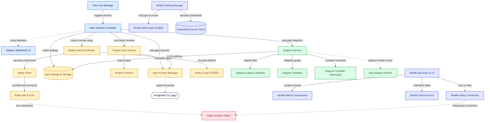

# Architecture

<!-- levity:diagram:start -->
## Architecture

Levity is a Windows tray assistant and developer sidebar for the Antigravity CLI \(agy\), providing repo switching, PowerShell task execution, automated architecture diagram generation, and remote access from a mobile web app\. The WPF desktop app coordinates local agy child processes and background jobs while bridging messages to an embedded WebView2 UI and an end\-to\-end encrypted Cloudflare Worker WebSocket relay\. Remote paired phones interact with the desktop session over this encrypted relay without requiring incoming open ports on the host PC\.

Colours: Desktop Application \(WPF\); Desktop Core Services; Diagram Generation Engine; Cloudflare Relay; Mobile Web App \(React\) (in this order: blue, amber, green, rose, indigo, teal, then repeating).

Solid arrows are backed by a reference in the code. Dashed arrows are inferred: plausible, but no reference was found in the files that were read.

### Components

- **Main Window Controller**: [`MainWindow.xaml.cs`](../MainWindow.xaml.cs)
- **Sidebar WebView2 UI**: [`wwwroot/app.js`](../wwwroot/app.js)
- **Tray Icon Manager**: [`Services/TrayIconManager.cs`](../Services/TrayIconManager.cs)
- **Agy Process Manager**: [`Services/AgyProcessManager.cs`](../Services/AgyProcessManager.cs)
- **App Settings &amp; Storage**: [`Services/AppSettings.cs`](../Services/AppSettings.cs)
- **Project Scanner**: [`Services/ProjectScanner.cs`](../Services/ProjectScanner.cs)
- **Project Sync Service**: [`Services/ProjectSyncService.cs`](../Services/ProjectSyncService.cs)
- **Mobile Hub Coordinator**: [`Services/MobileHub.cs`](../Services/MobileHub.cs)
- **Relay Client**: [`Services/RelayClient.cs`](../Services/RelayClient.cs)
- **Relay Crypto \(E2EE\)**: [`Services/RelayCrypto.cs`](../Services/RelayCrypto.cs)
- **Relay Net &amp; DoH**: [`Services/RelayNet.cs`](../Services/RelayNet.cs)
- **Antigravity CLI \(agy\)**
- **Diagram Service**: [`Services/DiagramService.cs`](../Services/DiagramService.cs)
- **Diagram Ingest &amp; Sanitize**: [`Services/DiagramIngest.cs`](../Services/DiagramIngest.cs)
- **Diagram Validator**: [`Services/DiagramValidator.cs`](../Services/DiagramValidator.cs)
- **Diagram Compiler \(Mermaid\)**: [`Services/DiagramCompiler.cs`](../Services/DiagramCompiler.cs)
- **Agy Diagram Runner**: [`Services/DiagramService.cs`](../Services/DiagramService.cs)
- **Relay Durable Object**: [`relay/src/index.ts`](../relay/src/index.ts)
- **Mobile App Entry &amp; UI**: [`web/src/App.tsx`](../web/src/App.tsx)
- **Mobile Sheet Components**: [`web/src/components/ProjectsSheet.tsx`](../web/src/components/ProjectsSheet.tsx)
- **Mobile Chat Protocol**: [`web/src/lib/chat.ts`](../web/src/lib/chat.ts)
- **Mobile Pairing Manager**: [`web/src/lib/pairing.ts`](../web/src/lib/pairing.ts)
- **Mobile WebCrypto \(E2EE\)**: [`web/src/lib/crypto.ts`](../web/src/lib/crypto.ts)
- **IndexedDB Device Store**: [`web/src/lib/store.ts`](../web/src/lib/store.ts)
- **Mobile Relay Connection**: [`web/src/lib/relay.ts`](../web/src/lib/relay.ts)

_Generated by Levity on 2026-10-27 from commit `a9fd3c8`. Re-run it to refresh this section; text outside the markers is never touched._
<!-- levity:diagram:end -->
